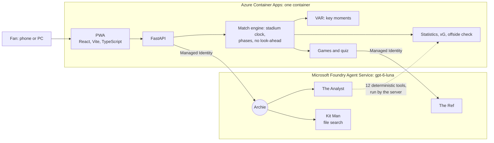

# statseat

> **60,000 fans in the stadium. Zero stats. We fix that.**
> *A multi-agent match-intelligence app on Microsoft Foundry: deterministic statistics, grounded AI explanations, one experience per seat.*

**Try it:** **[live demo](https://ca-statseat-ewwubzrkf5dus.happyriver-a61de2d4.switzerlandnorth.azurecontainerapps.io/)** · DEMO ticket code **`GNT-SYN001-D-WHQF-W1S6`** (works on several devices, with the phase panel and the Inspector) · [2-minute video](https://youtu.be/EYYiDv0j48o) · [demo guide](docs/DEMO.md)

Everything you see is **synthetic**: the country of Meridia, its 44 clubs, the players, the stadium and the match. No real person, club or brand appears anywhere.

---

## The problem

A fan watching on TV gets live statistics, replays and an expert explaining what just happened. The 60,000 people actually in the stadium get a scoreboard. They have the best seat and the least information.

## What statseat does

statseat is a phone app opened with the code on the fan's ticket. It follows the match as it is played and changes with the phase:

| Phase | What the fan gets |
|---|---|
| **Pre-match** | Line-ups on the pitch, squads, the stadium, today's officials |
| **Live** | Score, the event feed, shots, cards: only what matters while the ball is in play |
| **Data & Statistics** (from kick-off) | Six tables and the charts: distance, speed, intensity, passes, ball circulation, xG, momentum, shot map, zones, defensive line. One *mirror chart* for every series over time: home team above the axis, away team below |
| **Games** (half-time) | Tic Tac Goal, Guess the player and a quiz on the first half, with a stadium leaderboard and the sponsor's prize |
| **Recap** (full time) | The story of the match, the key moments and the fan's 3 favourite players, also as a PDF |
| **Ask Archie** (always) | A chat with Archie, an original old-school commentator, who answers in the fan's language with numbers checked against the data |

Every ticket gets its own experience: **Fan** (silver) or **Analyst** (gold), 3 favourite players, 8 interface languages and any language in the chat. In Fan, the Analyst metrics are shown blurred, with "Unlock with Gold".

## How it works, in one line

**The code computes every number, the agents explain it, and every number an agent says is checked.**



| Agent | Role |
|---|---|
| **Archie** | Orchestrator and voice. Reads the server's MATCH CONTEXT, picks the specialist, answers in the fan's language and version |
| **The Analyst** | Statistics up to the current minute through 12 deterministic tools, with the fan's session (no future, Fan or Analyst) |
| **Kit Man** | Clubs, players' backgrounds, stadium, officials and the Laws of the Game, by file search over 9 matchday documents |
| **The Ref** | Rewrites the half-time quiz in the fan's language; the code chooses the questions and the right answers |
| **VAR** | Deterministic, in the background: picks and labels the key moments for the timeline and the Recap |

More in [ARCHITECTURE.md](docs/ARCHITECTURE.md) and [METHODS.md](docs/METHODS.md).

## Built with Microsoft

| Technology | What it does in statseat |
|---|---|
| **Microsoft Foundry Agent Service** | Hosts the four prompt agents on `gpt-6-luna`: Archie and The Analyst with function tools, Kit Man with file search over the matchday documents, The Ref for the quiz |
| **Microsoft Agent Framework** | Runs the agents from the server (`agent-framework-foundry`): tool calls, the parallel start of The Analyst, the token budget per question |
| **Azure Container Apps** | One container for the API and the app, always on for the live match clock |
| **Azure Container Registry** | Builds the image in the cloud from the `Dockerfile` |
| **Azure Developer CLI (`azd`) and Bicep** | The whole system, from infrastructure to app, with one `azd up` |
| **Managed Identity and Entra ID** | The app reaches Foundry and the registry with no keys or secrets |
| **Log Analytics and Application Insights** | The container logs; Application Insights provisioned by the same Bicep template |

---

## Why statseat

### A synthetic world, measured
- **A whole synthetic football world**, not a CSV: 44 clubs with squads, careers, a stadium and its history, and a full match (SYN-001) with events and **tracking at 25 Hz**, calibrated on aggregates of six open professional matches.
- **Realism is measured, not claimed.** SYN-001 goes through the same data pipeline as the real matches, and the realism report is public, red lights included: **21 green, 22 yellow, 64 red** on 107 metrics. We say what is not realistic yet.
- **A deterministic, tested pipeline** that finds every goal of the real calibration matches (16 of 16) and locates events from the trajectories.
- **Microsoft stack end to end:** Foundry Agent Service, Microsoft Agent Framework, Azure Container Apps, `azd` and Bicep, Managed Identity, Application Insights.

### Agents with distinct roles
- **Four agents with distinct roles** and one deterministic background agent: Archie orchestrates, The Analyst calls tools, Kit Man searches documents, The Ref rewrites the quiz, VAR picks the moments in code.
- **Grounding on every number.** A validator reads every number in an answer, in any language, and matches it with a tool result or the match context. If one does not match, Archie rewrites once; then the answer is discarded.
- **The Analyst starts in parallel** with Archie, cutting answers with numbers from about 12 s to about 6 s.
- **Graceful failure:** if Foundry does not answer, the fan gets a deterministic card from the engine, never an error.

### Impact
- **Every seat becomes a smart seat**, for the fans who are already there and paid the most.
- **About $0.001 per question** (15 test questions cost $0.018 in all), on one small container.
- **A clear path to production:** club ticketing and login, loyalty points from the games, more clubs, a real-time feed ([ROADMAP.md](docs/ROADMAP.md)).

### The fan's experience
- **An interface that follows the match**, phase by phase, so the fan is never shown what does not matter now.
- **Archie**, an original character with a voice of his own, who never draws charts but points to the right table.
- **One chart for every series over time**, the mirror chart, readable at a glance in a stadium.
- **Games at half-time** with a sponsor's prize, and a **Recap in PDF** to take home.

### Built for production
- **Reliability:** grounding on every number, no look-ahead (the server never releases the future), a deterministic fallback.
- **Transparency:** the Inspector (DEMO tickets) shows the agents, tools, tokens, latency, cost and grounding of every answer, and how every statistic is computed.
- **Controls:** the match comes from the ticket on the server, never from the model; one device per fan ticket; a token budget and call limits per question; no keys anywhere (Managed Identity).
- **Adoption:** the whole system is deployed with one command, `azd up`.

---

## Run it

**Online:** open the demo link above and type a DEMO code (the [demo guide](docs/DEMO.md) has a 5-minute tour).

**Locally** (Python 3.12, Node 22, `az login` with the *Azure AI User* role on the Foundry project):

```bash
cp .env.example .env                       # Foundry endpoint, model and agent versions
python -m pip install -r app/requirements.txt
python -m app.engine                       # backend on http://localhost:8000, Archie on Foundry
cd web && npm install && npm run dev       # the app on http://localhost:5173
```

Without the Foundry variables the app still runs, with a scripted Archie. **Deploy:** `azd up` ([infra/README.md](infra/README.md)).

## Repository

| Folder | What |
|---|---|
| [`app/`](app/) | FastAPI backend: API contract, match engine, statistics, VAR, games, agents ([agents](app/agents/README.md)) |
| [`web/`](web/) | The PWA (React, Vite, TypeScript), 8 languages |
| [`generator/`](generator/) | The synthetic universe, the match and the tickets |
| [`data_pipeline/`](data_pipeline/) | Deterministic data preparation, metrics and the realism report |
| [`calibration/`](calibration/) | Aggregate statistics used to calibrate the generator and the xG model |
| [`synthetic/`](synthetic/) | SYN-001: events, tracking, tickets, Kit Man's documents |
| [`prompts/`](prompts/) | The agents' instructions and the prompts used to build the project with AI coding assistants |
| [`infra/`](infra/) | Bicep for `azd`: Container Apps, registry, identity, Application Insights |
| [`docs/`](docs/) | Architecture, methods, demo guide, roadmap, data guidelines |

## Data and licences

- Code: [MIT licence](LICENSE).
- The generator and the xG model are calibrated on **aggregate statistics** of six matches of the open DFL/Sportec dataset: Bassek, M., Rein, R., Weber, H., Memmert, D. (2025), *An integrated dataset of spatiotemporal and event data in elite soccer*, Scientific Data 12:195, [doi:10.1038/s41597-025-04505-y](https://doi.org/10.1038/s41597-025-04505-y), CC-BY 4.0. The raw data are never in this repository, the app or the video.
- The architecture follows the patterns of [`bbenz/football-results-dashboard`](https://github.com/bbenz/football-results-dashboard) (MIT): deterministic tools, a grounding validator, keyless identity.
