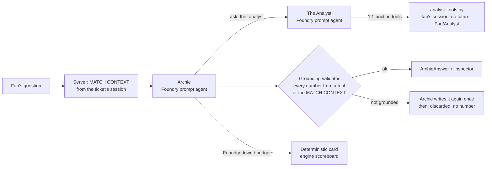

# statseat agents

The agents of the app: **The Analyst's tools**, the deterministic functions
behind every number Archie says, and **Ask Archie on Microsoft Foundry**: Archie and The Analyst as Foundry
prompt agents, run with Microsoft Agent Framework, with the grounding validator and the Inspector.

## Ask Archie (`archie.py`)



| File | What |
|---|---|
| [`context.py`](context.py) | The MATCH CONTEXT block, built by the server from the session: match, phase and minute, score and scorers, coaches, captains, referee, the fan's version, language and favourites, the open sections. `match_id` never comes from the model |
| [`foundry.py`](foundry.py) | The two agent definitions (instructions from [`prompts/archie/`](../../prompts/archie/) and [`prompts/analyst/`](../../prompts/analyst/), the tools, Archie's JSON reply format), `setup()` to create their versions, and the Agent Framework `FoundryAgent`s of one question (keyless `DefaultAzureCredential`, round-trip and tool-call limits, a middleware that counts tokens and stops at the budget) |
| [`grounding.py`](grounding.py) | The validator: reads the numbers of the answer in any language and matches each one with a tool result (`numeric_fields` paths) or the MATCH CONTEXT, at the precision written |
| [`archie.py`](archie.py) | one question: context, Archie, The Analyst's tools with the fan's session, grounding (one rewrite, then discard), the deterministic card if Foundry fails, `ArchieAnswer` with `grounding`, `points_to` and the Inspector (agents, tool calls, tokens, latency, cost) |
| [`settings.py`](settings.py) | environment variables ([`.env.example`](../../.env.example)), prices for the Inspector's cost |

`POST /api/archie/ask` uses it when `FOUNDRY_PROJECT_ENDPOINT`, `ARCHIE_AGENT_ID` and `ANALYST_AGENT_ID` are set;
otherwise the contract mock answers, as before. Prompt agents own their tool declarations on Foundry: the request
only names the agent and its version (`agent_reference`), and the server runs the functions.

```bash
az login                                           # the account needs Azure AI User on the Foundry project
python -m app.agents setup --dry-run               # the definitions, no call to Foundry
python -m app.agents setup                         # creates The Analyst and the new Archie version (Foundry)
python -m app.agents ask "Who has run the most?" "¿Quién ha corrido más?" --phase first_half --minute 30
python -m app.engine                               # the app with Archie on Foundry (reads .env)
```

Tests: [`app/tests/test_archie.py`](../tests/test_archie.py), with a fake Foundry
([`fake_foundry.py`](../tests/fake_foundry.py)) behind the real Agent Framework client: answer format and Inspector,
`match_id` from the server, no future when the model asks for it, no Analyst number with a Fan ticket, an invented
number rewritten or discarded, the card when Foundry is down, the token budget, the mock without Foundry.

### Archie v8: faster answers, the right table, the Analyst plan

- **The Analyst starts in parallel with Archie.** A question with numbers waits for four model calls in a row
  (Archie decides, The Analyst picks a tool, The Analyst writes the data result, Archie answers), each 2.5–4.5 s and
  almost all of it the fixed cost of a call. So the server starts The Analyst on the fan's own words while Archie
  reads the question; Archie's first `ask_the_analyst` takes that run, about 3 s sooner. A run that Archie does not
  use (Kit Man questions, the score, out-of-scope questions) is stopped or discarded: its tokens count in the total
  and the cost, never in the grounding, and the Inspector says so. One token budget for both (`ARCHIE_MAX_TOKENS`,
  now 30,000); `ARCHIE_PREFETCH_ANALYST=0` turns it off.
- **The table of the number (path B).** When Archie gives The Analyst's numbers without a `chart`, the server points
  to the table of the first tool that has one (`table_for`: `distance` and `speeds` → `running_table`, `passes` →
  `ball_table`, `shots`, `possession` and `team_stats` → `match_table`, `expected_goals` → `match_table` in Fan and
  `xg_cumulative` in Analyst, the player tools → `player_focus` for favourites or `players_table` in Analyst), only
  for a grounded answer in scope, with Data & Statistics open. The Inspector says the server chose it.
- **What a Fan ticket shows locked.** The MATCH CONTEXT of a Fan ticket lists the Analyst-only tables and charts
  (`stats.CHARTS` and `ANALYZER_TABLES` of the contract), and a pointer to one of them is `locked` with no phase:
  the app then shows the same note as Data & Statistics. Archie's rule is in his instructions (v8).

## Kit Man (`kitman.py`)

Archie's second tool, `ask_kit_man`: the clubs, the players' backgrounds and nicknames, the stadium, today's officials
and the Laws of the Game, from the matchday documents of SYN-001 (the Kit Man agent agent `kitman`, file search on the vector
store `kitman-SYN-001`). `ask_kitman()` calls it by name and version through the Responses API, strips the citation
markers and returns the text, the documents used (citations, else the file search results), tokens and latency; it
never raises (on an error Archie hears that Kit Man is not available). Kit Man reads about 10,000 tokens per question:
Archie may call him **once per question** (counted before the call, also when two calls arrive in parallel) and never
for the numbers of the match. The numbers of his answer (years, capacity) become grounding sources `ask_kit_man`;
the Inspector shows the Kit Man step and his documents as `kitman:<file>` evidence. Agent and version:
`KITMAN_AGENT_ID` and `KITMAN_AGENT_VERSION`, default `kitman` version 2. Tests: `app/tests/test_kitman.py` (fake
Foundry).

## The Ref (`the_ref.py`)

Not one of Archie's tools: the quizmaster of the half-time games. The games code chooses the quiz questions, the
options and the right answers; The Ref (agent `the-ref`, instructions in `prompts/the_ref/`) only rewrites the
text of the questions and options in the fan's language (`preferences.language`). The questions are the same for every
fan, so the quiz routes call it **once per match, phase and language** (the first fan of a language waits about 3 s,
the others get the text from memory) and never send the right answer. Every item is checked before it is shown (same
options in the same order, same numbers, player names and club names unchanged, a question of at most 120
characters); an item that fails keeps the code's English, and if Foundry does not answer the whole quiz does (the
result is kept too: no second call). Scoring is still by `option_id`. Called directly with the Responses API, sync like
the quiz routes. Agent and version: `THE_REF_AGENT_ID` and `THE_REF_AGENT_VERSION`, default `the-ref` version 1;
without `FOUNDRY_PROJECT_ENDPOINT` the quiz stays in English. Tests: `app/tests/test_the_ref.py` (fake The Ref).

## The Analyst's tools (`analyst_tools.py`)

Each tool is a pure function `tool(session, **arguments) -> dict`. It reads the match only through the engine's
no-look-ahead window (`engine.snapshot(token)`, then `Engine.core` / `Engine.live_core`, the same choice as the
server) and builds its result from the payloads of [`app/engine/stats.py`](../engine/stats.py), so its numbers are the
ones the app shows at the same instant.

| Tool | What it returns |
|---|---|
| `match_score` | score, phase, minute, goal scorers (the scoreboard of `/api/match/state`) |
| `match_events` | key events so far (goals, shots, penalties, cards, substitutions, corners, fouls, VAR), filtered by kind, team, player, minutes |
| `team_stats` | both teams side by side: shots, on target, goals, penalties, woodwork, corners, fouls, offsides, cards, sprints, tackles, recoveries, possession, passes, distance, ball circulation, counter-attacks; PPDA (Analyst) |
| `shots` | shots per team, each shot (minute, player, outcome, penalty, header, speed), the hardest shot of each team; xG per team (the "Goals vs xG" row, both versions); each shot's xG and chance word (Analyst) |
| `possession` | possession %, ball circulation in possession (km/h), effective playing time (per half, total, share of play) |
| `passes` | passes and accuracy per team, the top passer and the 3 players with most touches of each team; average length and long balls per team (Analyst) |
| `distance` | distance per team (splits in Analyst), the top runner of the match and of each team, the players who ran the most (Analyst) |
| `speeds` | fastest player per team (5 per team in Analyst), sprints and top sprinter, speed zones (Analyst), running intensity, acceleration load per team |
| `player_stats` | one player, the engine's Player Focus card: minutes, distance, top speed, sprints, shots, goals, passes, touches, tackles, recoveries, cards, fouls committed and won, acceleration load; xG (Analyst) |
| `compare_players` | two players side by side, with the numbers of `player_stats` |
| `expected_goals` | goals and xG per team (both versions); each shot's xG and chance word, big, decent or half (Analyst) |
| `offside_check` | the tracking check of an official offside or of the pass before a goal (`app/engine/offside.py`, 2 m band, `Materials/METRICS.md` §26), by `event_id` or `minute` (else the latest): verdict, margin (signed) and distance from the line (unsigned, as Archie says it), attacker, the official decision (`official`) and, if the check says onside on an offside call, a `note` that the referee's decision stands; both versions (Archie only, the app does not show it) |

Rules shared by every tool:

- **No future:** only data up to the session's instant; every result carries `as_of_s`. An argument cannot ask for
  more (`until_minute` beyond now returns the events so far with a note; `offside_check` on a future minute is an
  error).
- **Ticket version:** the version comes from the session. With a Fan ticket (Casual mode) a number that the app shows
  only in Analyst is null with the reason "Analyst only". For a single player, Fan gets the full card only for the
  fan's favourites (Player Focus); for the others, the timeline's numbers (minutes, shots, goals, cards, fouls) and a
  number only where the Fan tables show it (top runner, fastest, top sprinter, top passer, most touches).
- **Match scope:** the match is the one on the ticket; `match_id`, `mode` and `as_of_s` are not arguments and give an
  `out_of_scope` error.
- **No invented numbers:** a number that does not exist is null, and `unavailable` lists its path and reason (no
  tracking, no pass events in the source, the match has not started).
- **Stable paths:** every number has a fixed path (`teams.BRA.shots`, `distance.top_runner.km`); `numeric_fields`
  lists them for `GroundedValue.source_field`.

`run_tool(session, name, arguments)` validates the arguments against the tool's JSON schema, runs the tool and returns
a `ToolRun` with the result, a short summary for `ToolCall.result_summary` and the latency (`tool_call()` gives the
contract `ToolCall`). Wrong arguments (unknown player or team, another match, a bad value) give
`{"error": {"code", "message"}}`, never an exception. `function_tools()` gives the 12 definitions for function calling
(about 1,000 tokens in all). Players are found by id (`BRA-09`), team and shirt number (`BRA #9`) or name.

```python
from app.agents.analyst_tools import AnalystSession, run_tool
session = AnalystSession.from_state(engine, token, store.sessions[token])  # in the server
run_tool(session, "distance", {"team": "CAL"}).result
```

Tests: [`app/tests/test_analyst_tools.py`](../tests/test_analyst_tools.py), with a Fan and an Analyst ticket in
every phase (same numbers as `/api/match/state`, `/api/match/events`, `/api/stats` with its leaders, Player Focus
and players table, `/api/stats/live` and `/api/recap`), the truncation test (same results on the whole match and on a file cut at the instant), no Analyst
numbers in Fan, the metrics work placeholders and clear errors.
