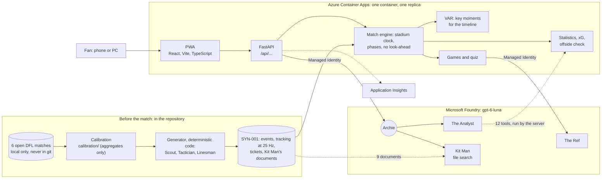
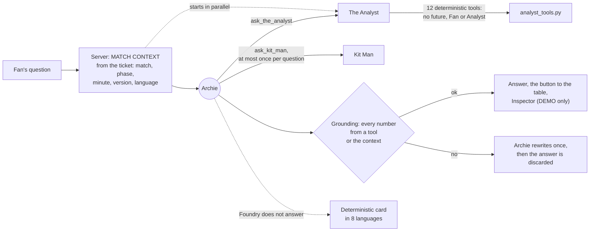
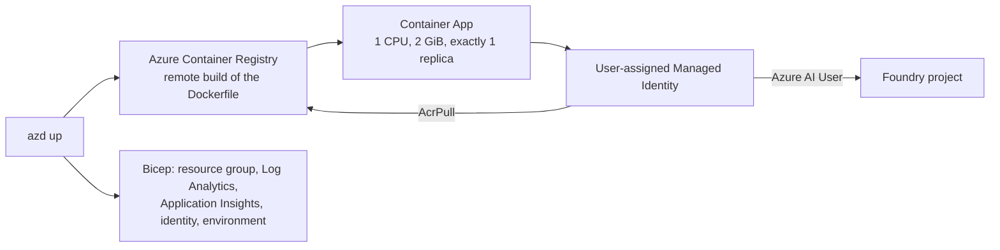

# Architecture

statseat is one container on **Azure Container Apps** that serves the API and the app, plus **five agents**: four prompt agents on **Microsoft Foundry Agent Service** and VAR, which is deterministic code. The rule behind every choice: **the code computes, the AI explains, and every number an agent says is checked.**

## The whole system

| Part | Where | What it does |
|---|---|---|
| **Generator** | [`generator/`](../generator/) | Builds the synthetic universe (Scout), the match script (Tactician) and checks realism (Linesman). Deterministic code, run once; the output is committed in [`synthetic/`](../synthetic/) |
| **Data pipeline** | [`data_pipeline/`](../data_pipeline/) | The same preparation for real and synthetic matches: validity mask, our own kinematics, events located from the trajectories ([guidelines](DATA_ANALYSIS_GUIDELINES.md)) |
| **Match engine** | [`app/engine/`](../app/engine/) | Replays SYN-001 on a stadium clock. A *snapshot* holds only what has happened so far: the future is never released, to the app or to the agents |
| **Statistics** | [`app/engine/stats.py`](../app/engine/stats.py) | Every number of Live, Data & Statistics and the Recap, computed in code ([metrics](../Materials/METRICS.md)) |
| **VAR** | [`app/engine/highlights.py`](../app/engine/highlights.py) | Picks the key moments (goals, big saves, woodwork, big chances…), scores and labels them from templates. No model call |
| **Games** | [`app/`](../app/) | Tic Tac Goal, Guess the player and the quiz; the code chooses every question and answer |
| **Agents** | [`app/agents/`](../app/agents/README.md) | Archie, The Analyst, Kit Man and The Ref on Foundry, run with Microsoft Agent Framework and the Responses API |
| **PWA** | [`web/`](../web/) | React, Vite and TypeScript, 8 languages, one section per phase |
| **Infrastructure** | [`infra/`](../infra/README.md) | Bicep for `azd`: Container Apps, registry, identity, Application Insights, the Foundry role |

## One question to Archie

1. **The server writes the MATCH CONTEXT** from the fan's session: match, phase and minute, score and scorers, captains and officials, the fan's version (Fan or Analyst), language and favourite players. The model never chooses the match.
2. **Archie** (prompt agent) decides what he needs. For numbers he calls `ask_the_analyst`; for clubs, players' backgrounds, the stadium and the rules he calls `ask_kit_man`, at most once per question.
3. **The Analyst** (prompt agent) answers with **12 tools that the server runs** with the fan's session: a tool can never read past the current instant, and with a Fan ticket a number that the app shows only to Analyst tickets is null. The server starts The Analyst in parallel with Archie, so a question with numbers waits for about two model calls instead of four.
4. **Kit Man** (prompt agent with file search) reads the 9 matchday documents of SYN-001 and returns the text and the documents used.
5. **The grounding validator** reads every number of Archie's answer, in any language and with either decimal separator, and matches it with a tool result, Kit Man's answer or the MATCH CONTEXT. Shirt numbers are checked against the line-ups only. One rewrite, then the answer is replaced by a line with no number.
6. **The answer** carries the table or chart it refers to (the app shows a button), and, for DEMO tickets, the Inspector: agents, tools and their arguments, tokens, latency, cost, grounding.

Limits per question: 4 model rounds and 4 tool calls per agent, 30,000 tokens, 30 s per call.

## The quiz and The Ref

The code of the games chooses the quiz questions, the options and the right answers from the match statistics so far. **The Ref** only rewrites the text in the fan's language, **once per match, phase and language**: the first fan of a language waits about 3 s, the others get it from memory. Each item is checked before it is shown (same options, same numbers and names); one that fails stays in the code's English. The right answer is never sent to the model.

## Deployment

- **One command:** `azd up` provisions everything and deploys; after a code change `azd deploy` is enough ([infra/README.md](../infra/README.md)).
- **No keys:** the app pulls its image and calls Foundry with a Managed Identity that has the least role needed (*Azure AI User*). Locally, `az login` and `DefaultAzureCredential`.
- **One replica on purpose:** sessions, the one-device rule and the stadium clock live in memory. SYN-001 loads in 30–45 s at start-up, and the start-up probe waits for it.
- **Configuration:** only environment variables ([`.env.example`](../.env.example)): Foundry endpoint, model, agent names and versions.

## Security and controls

| Control | How |
|---|---|
| Match scope | The match comes from the ticket on the server; `match_id` is never an argument of a tool or a choice of the model |
| No look-ahead | The engine releases only the events and frames up to the stadium clock; the tools inherit it |
| Ticket versions | Fan and Analyst numbers are separated in the tools, not in the prompt |
| Devices | Silver and gold tickets are bound to their first device; DEMO tickets work on several |
| Cost | Token budget and call limits per question; Kit Man at most once per question; The Ref once per phase and language |
| Secrets | None: Managed Identity and Entra ID |
| Failure | A deterministic card from the engine when Foundry fails; the quiz stays in English |

## From the demo to production

The demo is one container with the state in memory, which is the simplest thing that works for one match. A production version for a 60,000-seat stadium would split it: Event Hubs for the official feed, Cosmos DB for sessions and points, Web PubSub for live updates, Key Vault, several replicas and load tests. See [ROADMAP.md](ROADMAP.md).
