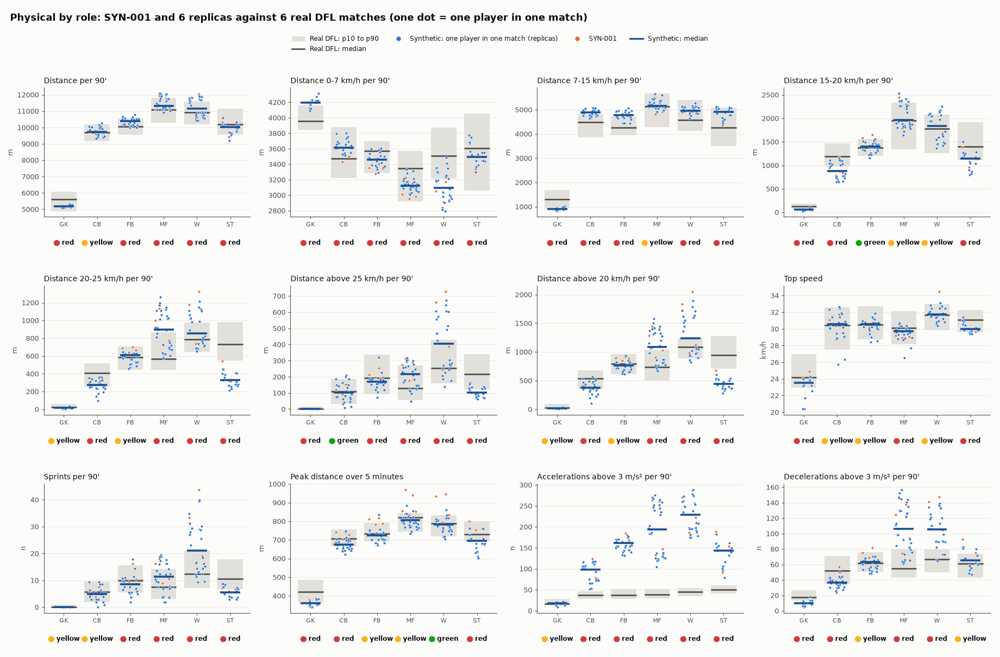
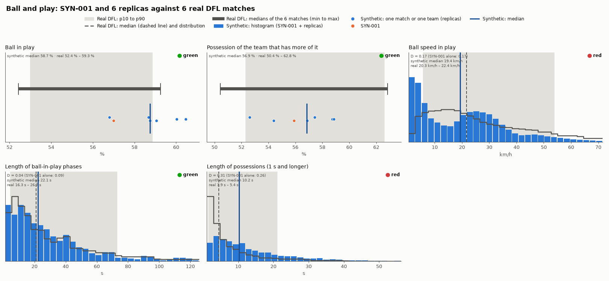
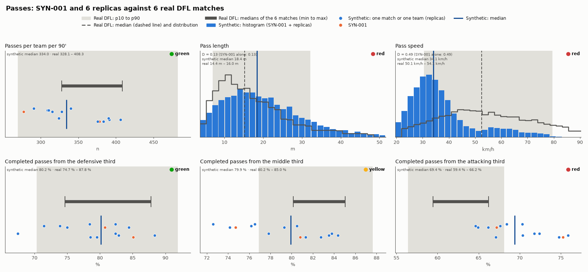
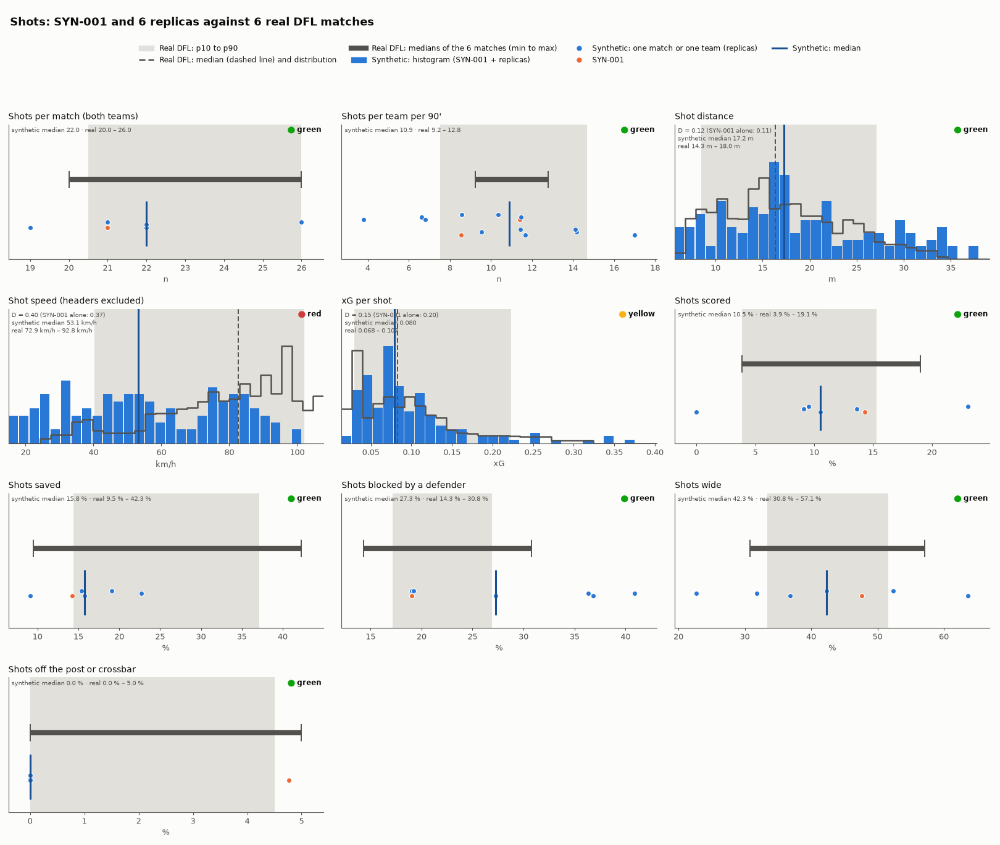
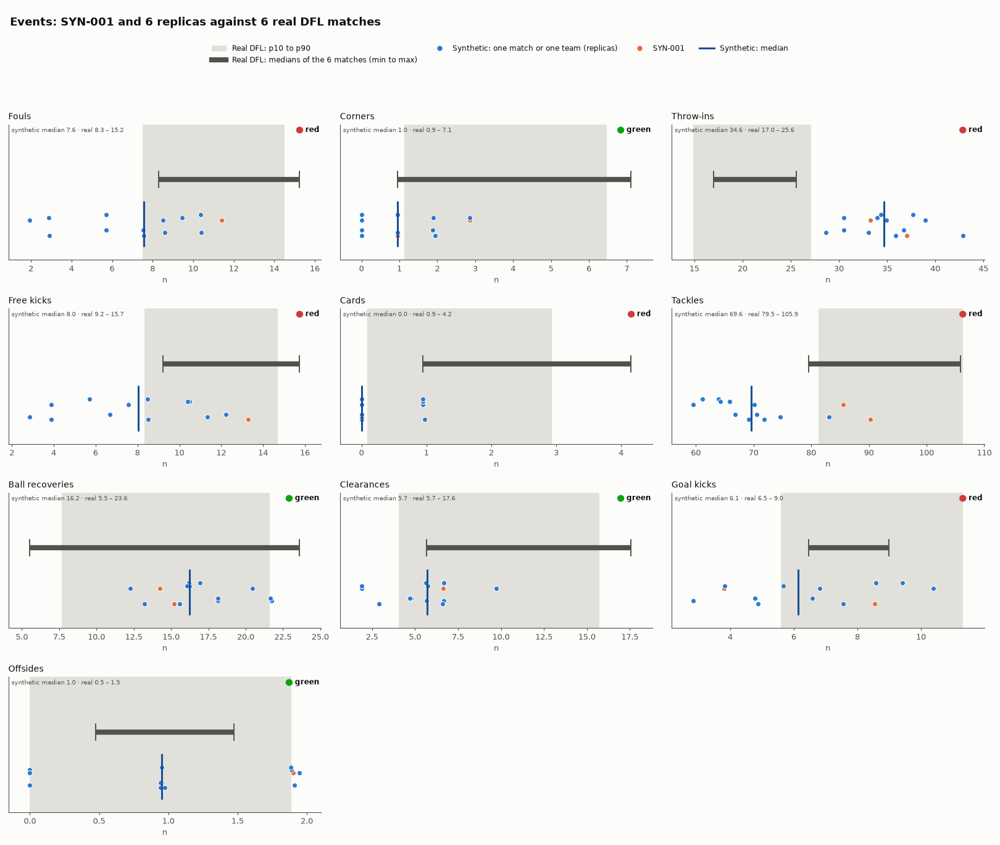
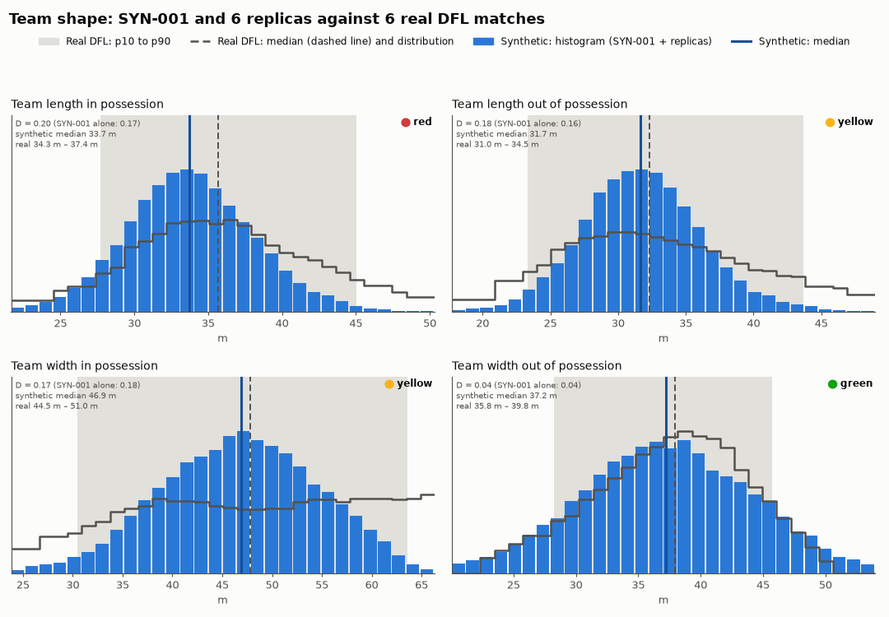
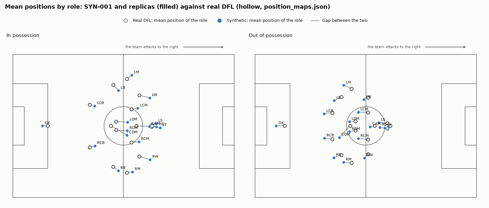

# Linesman: how realistic the synthetic match SYN-001 is

> Generated by `cd data_pipeline && .venv/bin/python -m insidethegame_data.realism SYN-001 --replicas 6`: do not edit by hand. Every number is in [`realism.json`](realism.json), the figures in [`figures/`](figures/).
> Real data: only aggregates of the 6 DFL/Sportec matches (Bassek et al. 2025, Scientific Data 12:195, https://doi.org/10.1038/s41597-025-04505-y, CC-BY 4.0) in `calibration/realism_reference.json`; no raw, per-frame or per-person data. Synthetic data: the invented universe of Meridia.

## In short

- **107 metrics**: 21 green, 22 yellow, 64 red (SYN-001 and 6 replicas together). SYN-001 alone: 20 green, 7 yellow, 80 red.
- By group: physical by role 3/18/51; ball and play 3/0/2; passes 2/1/3; shots 8/1/1; events 4/0/6; team shape 1/2/1 (green/yellow/red).
- To read with care: 27 of the yellow or red metrics have the median inside the real range and a D no larger than chance would give with so few values (column "D by chance"); 26 of them are physical metrics by role, with few player-matches per side.
- The first things to improve, ranked by how visible they are in a 2-minute video, are in [What to improve in the generator](#what-to-improve-in-the-generator).

## How to read it

- **The same pipeline on both sides.** The 6 DFL matches and the synthetic matches (SYN-001 plus 6 replicas: same fixture and same squads, no script) go through the same preparation (`qc.py`, guidelines v4.2) and the same metric code (`realism_metrics.py`). Only valid samples are used.
- **Kolmogorov-Smirnov D**: the largest gap between the synthetic and the real cumulative distribution (rebuilt from the 21 stored quantiles, see [Technical details](#technical-details)). 0 means identical distributions, 1 fully separate.
- **Median rule**: where the synthetic median falls against the range of the medians of the 6 real matches (min to max).
- **Traffic light** (on the full synthetic sample, SYN-001 plus replicas): **green** if D ≤ 0.15 and the median is inside the range; **yellow** if D is between 0.15 and 0.3 or the median is just outside (within 10 % of the range width); **red** if D > 0.3 or the median is far outside.
- **Metrics with one value per match or per team** (ball in play, possession, counts per team, shot outcomes): with 6-7 values the KS test makes no sense, so only the median rule applies (D = –).
- **†** = small sample (fewer than 20 values on one side): indicative result.
- **D by chance (95 %)**: the D that two samples of these sizes drawn from the *same* distribution exceed only 5 times in 100 (critical value of the two-sample KS test). It is not part of the traffic light, which follows fixed thresholds: it shows whether a high D can be just noise. With 12-35 player-matches per side it is 0.3-0.5; for per-frame samples (ball speed, team shape) it is very low but optimistic, because nearby frames are not independent.
- Physical values are per 90 minutes of measured time, players with at least 60 valid minutes, as in `calibration/physical_profiles.json`.

## 1. Physical by role

| Metric | Goalkeepers | Centre-backs | Full-backs | Midfielders | Wide players | Strikers |
|---|---|---|---|---|---|---|
| Distance per 90' | **red** (D 0.62; chance 0.53) † | **yellow** (D 0.23; chance 0.37) | **red** (D 0.45; chance 0.40) | **red** (D 0.40; chance 0.33) | **red** (D 0.33; chance 0.40) | **red** (D 0.35; chance 0.44) † |
| Distance 0-7 km/h per 90' | **red** (D 0.69; chance 0.53) † | **red** (D 0.49; chance 0.37) | **red** (D 0.45; chance 0.40) | **red** (D 0.59; chance 0.33) | **red** (D 0.65; chance 0.40) | **red** (D 0.36; chance 0.44) † |
| Distance 7-15 km/h per 90' | **red** (D 0.87; chance 0.53) † | **red** (D 0.72; chance 0.37) | **red** (D 0.75; chance 0.40) | **yellow** (D 0.26; chance 0.33) | **red** (D 0.69; chance 0.40) | **red** (D 0.52; chance 0.44) † |
| Distance 15-20 km/h per 90' | **red** (D 0.71; chance 0.53) † | **red** (D 0.56; chance 0.37) | green (D 0.14; chance 0.40) | **yellow** (D 0.29; chance 0.33) | **yellow** (D 0.27; chance 0.40) | **red** (D 0.63; chance 0.44) † |
| Distance 20-25 km/h per 90' | **yellow** (D 0.28; chance 0.53) † | **red** (D 0.58; chance 0.37) | **yellow** (D 0.15; chance 0.40) | **red** (D 0.51; chance 0.33) | **red** (D 0.37; chance 0.40) | **red** (D 0.92; chance 0.44) † |
| Distance above 25 km/h per 90' | **red** (D 0.40; chance 0.53) † | green (D 0.15; chance 0.37) | **red** (D 0.42; chance 0.40) | **red** (D 0.34; chance 0.33) | **red** (D 0.38; chance 0.40) | **red** (D 0.76; chance 0.44) † |
| Distance above 20 km/h per 90' | **yellow** (D 0.28; chance 0.53) † | **red** (D 0.47; chance 0.37) | **yellow** (D 0.29; chance 0.40) | **red** (D 0.49; chance 0.33) | **red** (D 0.46; chance 0.40) | **red** (D 0.92; chance 0.44) † |
| Top speed | **red** (D 0.40; chance 0.53) † | **yellow** (D 0.17; chance 0.37) | **yellow** (D 0.25; chance 0.40) | **red** (D 0.35; chance 0.33) | **yellow** (D 0.28; chance 0.40) | **red** (D 0.57; chance 0.44) † |
| Sprints per 90' | **yellow** (D 0.20; chance 0.53) † | **yellow** (D 0.28; chance 0.37) | **red** (D 0.34; chance 0.40) | **red** (D 0.38; chance 0.33) | **red** (D 0.42; chance 0.40) | **red** (D 0.67; chance 0.44) † |
| Peak distance over 5 minutes | **red** (D 0.84; chance 0.53) † | **red** (D 0.40; chance 0.37) | **yellow** (D 0.23; chance 0.40) | **yellow** (D 0.23; chance 0.33) | green (D 0.12; chance 0.40) | **red** (D 0.53; chance 0.44) † |
| Accelerations above 3 m/s² per 90' | **yellow** (D 0.27; chance 0.53) † | **red** (D 1.00; chance 0.37) | **red** (D 1.00; chance 0.40) | **red** (D 1.00; chance 0.33) | **red** (D 1.00; chance 0.40) | **red** (D 1.00; chance 0.44) † |
| Decelerations above 3 m/s² per 90' | **red** (D 0.75; chance 0.53) † | **red** (D 0.63; chance 0.37) | **yellow** (D 0.18; chance 0.40) | **red** (D 0.68; chance 0.33) | **red** (D 0.82; chance 0.40) | **yellow** (D 0.20; chance 0.44) † |

Medians (synthetic / real, range of the medians per match):

| Metric | Goalkeepers | Centre-backs | Full-backs | Midfielders | Wide players | Strikers |
|---|---|---|---|---|---|---|
| Distance per 90' | 5 196 m / 5 067 m – 6 011 m | 9 738 m / 9 467 m – 9 968 m | 10 395 m / 9 798 m – 10 622 m | 11 322 m / 10 352 m – 11 467 m | 11 159 m / 10 586 m – 11 191 m | 10 022 m / 9 578 m – 10 949 m |
| Distance 0-7 km/h per 90' | 4 197 m / 3 805 m – 4 186 m | 3 616 m / 3 373 m – 3 879 m | 3 457 m / 3 328 m – 3 593 m | 3 121 m / 3 118 m – 3 542 m | 3 093 m / 3 276 m – 3 785 m | 3 497 m / 3 131 m – 3 804 m |
| Distance 7-15 km/h per 90' | 912 m / 976 m – 1 586 m | 4 882 m / 4 160 m – 4 692 m | 4 776 m / 3 941 m – 4 399 m | 5 163 m / 4 728 m – 5 547 m | 4 965 m / 4 395 m – 4 921 m | 4 902 m / 3 641 m – 5 002 m |
| Distance 15-20 km/h per 90' | 60.9 m / 94.0 m – 238 m | 875 m / 1 004 m – 1 404 m | 1 398 m / 1 255 m – 1 830 m | 1 964 m / 1 355 m – 2 188 m | 1 835 m / 1 439 m – 1 942 m | 1 146 m / 1 271 m – 1 693 m |
| Distance 20-25 km/h per 90' | 18.3 m / 13.7 m – 47.2 m | 274 m / 328 m – 486 m | 610 m / 476 m – 801 m | 901 m / 518 m – 692 m | 857 m / 682 m – 916 m | 327 m / 563 m – 835 m |
| Distance above 25 km/h per 90' | 0.0 m / 0.0 m – 15.2 m | 102 m / 49.3 m – 158 m | 168 m / 99.0 m – 313 m | 217 m / 58.2 m – 195 m | 405 m / 187 m – 416 m | 103 m / 153 m – 315 m |
| Distance above 20 km/h per 90' | 18.3 m / 13.7 m – 56.3 m | 377 m / 396 m – 658 m | 766 m / 600 m – 1 115 m | 1 091 m / 576 m – 869 m | 1 241 m / 990 m – 1 180 m | 445 m / 762 m – 1 116 m |
| Top speed | 23.5 km/h / 22.7 km/h – 25.8 km/h | 30.6 km/h / 27.8 km/h – 31.3 km/h | 30.6 km/h / 29.2 km/h – 31.0 km/h | 29.7 km/h / 29.3 km/h – 31.4 km/h | 31.8 km/h / 30.5 km/h – 32.8 km/h | 30.0 km/h / 30.1 km/h – 31.9 km/h |
| Sprints per 90' | 0.0 / 0.0 – 0.5 | 4.8 / 3.2 – 7.0 | 8.5 / 5.6 – 13.6 | 11.4 / 3.5 – 8.6 | 21.1 / 10.0 – 19.2 | 5.5 / 7.9 – 14.3 |
| Peak distance over 5 minutes | 362 m / 392 m – 479 m | 674 m / 669 m – 734 m | 723 m / 704 m – 755 m | 805 m / 772 m – 833 m | 784 m / 761 m – 800 m | 694 m / 694 m – 798 m |
| Accelerations above 3 m/s² per 90' | 18.5 / 13.2 – 25.2 | 97.7 / 30.7 – 46.0 | 161.3 / 32.0 – 48.5 | 194.2 / 33.3 – 45.6 | 228.7 / 36.5 – 54.1 | 143.5 / 41.0 – 58.1 |
| Decelerations above 3 m/s² per 90' | 10.1 / 11.8 – 23.8 | 36.2 / 40.4 – 61.5 | 63.2 / 52.6 – 89.5 | 105.8 / 51.8 – 76.6 | 105.3 / 59.4 – 80.2 | 65.3 / 45.4 – 70.0 |

Of 72 metric × role combinations: 3 green, 18 yellow, 51 red; 26 yellow or red ones have the median inside the real range and a D within chance. Furthest from real, with the synthetic median far from the range in at least 3 roles: distance 7-15 km/h per 90' (higher for centre-backs, full-backs; lower for goalkeepers); distance 15-20 km/h per 90' (lower for goalkeepers, centre-backs, strikers); distance 20-25 km/h per 90' (higher for midfielders; lower for centre-backs, strikers); distance above 20 km/h per 90' (higher for midfielders, wide players; lower for strikers); sprints per 90' (higher for midfielders, wide players; lower for strikers); accelerations above 3 m/s² per 90' (higher for centre-backs, full-backs, midfielders, wide players, strikers); decelerations above 3 m/s² per 90' (higher for midfielders, wide players; lower for goalkeepers, centre-backs). Close to real in the median (inside the range in at least 4 roles of 6, though the distribution shape may differ): distance per 90', distance 0-7 km/h per 90', distance above 25 km/h per 90', top speed, peak distance over 5 minutes.

*Figure: each column is a role; the grey band goes from the 10th to the 90th real percentile, the grey line is the real median; the dots are the synthetic players (orange: SYN-001), the blue line is the synthetic median. The traffic light is under each column.*

## 2. Ball and play

| Metric | Light | D (all) | D by chance (95 %) | D (SYN-001 alone) | Synthetic median | SYN-001 median | Real: medians per match (min – max) | n synthetic / real |
|---|---|---|---|---|---|---|---|---|
| Ball in play | green | – | – | – | 58.7 % | 57.0 % | 52.4 % – 59.3 % | 7 / 6 |
| Possession of the team that has more of it | green | – | – | – | 56.9 % | 55.9 % | 50.4 % – 62.8 % | 7 / 6 |
| Ball speed in play | **red** | 0.17 | 0.00 | 0.17 | 19.4 km/h | 19.8 km/h | 20.3 km/h – 22.4 km/h | 578 021 / 480 533 |
| Length of ball-in-play phases | green | 0.04 | 0.07 | 0.09 | 22.1 s | 20.4 s | 16.3 s – 26.7 s | 773 / 604 |
| Length of possessions (1 s and longer) | **red** | 0.31 | 0.04 | 0.26 | 10.2 s | 9.5 s | 3.9 s – 5.4 s | 1 743 / 2 253 |

Realistic: Ball in play, Possession of the team that has more of it, Length of ball-in-play phases. To review: Ball speed in play (red, synthetic lower than real); Length of possessions (1 s and longer) (red, synthetic higher than real).

*Figure: in the histograms the grey band goes from the 10th to the 90th real percentile, the grey outline is the real distribution, the blue bars the synthetic one; vertical lines: real median (dashed) and synthetic median (blue). In the dot panels, one dot per synthetic match or team (orange: SYN-001) and the grey bar with the medians of the 6 real matches. x axis from the 1st to the 99th percentile.*

## 3. Passes

| Metric | Light | D (all) | D by chance (95 %) | D (SYN-001 alone) | Synthetic median | SYN-001 median | Real: medians per match (min – max) | n synthetic / real |
|---|---|---|---|---|---|---|---|---|
| Passes per team per 90' | green | – | – | – | 334.0 | 327.8 | 328.1 – 408.3 | 14 / 12 |
| Pass length | **red** | 0.13 | 0.03 | 0.13 | 18.4 m | 18.4 m | 14.4 m – 16.0 m | 4 999 / 4 522 |
| Pass speed | **red** | 0.49 | 0.03 | 0.49 | 34.1 km/h | 33.4 km/h | 50.1 km/h – 54.1 km/h | 4 999 / 4 522 |
| Completed passes from the defensive third | green | – | – | – | 80.2 % | 82.9 % | 74.7 % – 87.8 % | 14 / 12 |
| Completed passes from the middle third | **yellow** | – | – | – | 79.9 % | 77.8 % | 80.2 % – 85.0 % | 14 / 12 |
| Completed passes from the attacking third | **red** | – | – | – | 69.4 % | 71.2 % | 59.4 % – 66.2 % | 14 / 12 |

Realistic: Passes per team per 90', Completed passes from the defensive third. To review: Pass length (red, synthetic higher than real); Pass speed (red, synthetic lower than real); Completed passes from the middle third (yellow, synthetic lower than real); Completed passes from the attacking third (red, synthetic higher than real).

*Figure: in the histograms the grey band goes from the 10th to the 90th real percentile, the grey outline is the real distribution, the blue bars the synthetic one; vertical lines: real median (dashed) and synthetic median (blue). In the dot panels, one dot per synthetic match or team (orange: SYN-001) and the grey bar with the medians of the 6 real matches. x axis from the 1st to the 99th percentile.*

## 4. Shots

| Metric | Light | D (all) | D by chance (95 %) | D (SYN-001 alone) | Synthetic median | SYN-001 median | Real: medians per match (min – max) | n synthetic / real |
|---|---|---|---|---|---|---|---|---|
| Shots per match (both teams) | green | – | – | – | 22.0 | 21.0 | 20.0 – 26.0 | 7 / 6 |
| Shots per team per 90' | green | – | – | – | 10.9 | 10.0 | 9.2 – 12.8 | 14 / 12 |
| Shot distance | green | 0.12 | 0.16 | 0.11 | 17.2 m | 17.2 m | 14.3 m – 18.0 m | 151 / 124 |
| Shot speed (headers excluded) | **red** | 0.40 | 0.19 | 0.37 | 53.1 km/h | 77.5 km/h | 72.9 km/h – 92.8 km/h | 137 / 86 |
| xG per shot | **yellow** | 0.15 | 0.16 | 0.20 | 0.080 | 0.092 | 0.068 – 0.107 | 151 / 124 |
| Shots scored | green | – | – | – | 10.5 % | 14.3 % | 3.9 % – 19.1 % | 7 / 6 |
| Shots saved | green | – | – | – | 15.8 % | 14.3 % | 9.5 % – 42.3 % | 7 / 6 |
| Shots blocked by a defender | green | – | – | – | 27.3 % | 19.1 % | 14.3 % – 30.8 % | 7 / 6 |
| Shots wide | green | – | – | – | 42.3 % | 47.6 % | 30.8 % – 57.1 % | 7 / 6 |
| Shots off the post or crossbar | green | – | – | – | 0.0 % | 4.8 % | 0.0 % – 5.0 % | 7 / 6 |

Realistic: Shots per match (both teams), Shots per team per 90', Shot distance, Shots scored, Shots saved, Shots blocked by a defender, Shots wide, Shots off the post or crossbar. To review: Shot speed (headers excluded) (red, synthetic lower than real); xG per shot (yellow, different distribution shape, synthetic values lower).

*Figure: in the histograms the grey band goes from the 10th to the 90th real percentile, the grey outline is the real distribution, the blue bars the synthetic one; vertical lines: real median (dashed) and synthetic median (blue). In the dot panels, one dot per synthetic match or team (orange: SYN-001) and the grey bar with the medians of the 6 real matches. x axis from the 1st to the 99th percentile.*

## 5. Events

| Metric | Light | D (all) | D by chance (95 %) | D (SYN-001 alone) | Synthetic median | SYN-001 median | Real: medians per match (min – max) | n synthetic / real |
|---|---|---|---|---|---|---|---|---|
| Fouls | **red** | – | – | – | 7.6 | 9.5 | 8.3 – 15.2 | 14 / 12 |
| Corners | green | – | – | – | 1.0 | 1.9 | 0.9 – 7.1 | 14 / 12 |
| Throw-ins | **red** | – | – | – | 34.6 | 35.2 | 17.0 – 25.6 | 14 / 12 |
| Free kicks | **red** | – | – | – | 8.0 | 10.5 | 9.2 – 15.7 | 14 / 12 |
| Cards | **red** | – | – | – | 0.0 | 0.5 | 0.9 – 4.2 | 14 / 12 |
| Tackles | **red** | – | – | – | 69.6 | 87.9 | 79.5 – 105.9 | 14 / 12 |
| Ball recoveries | green | – | – | – | 16.2 | 14.7 | 5.5 – 23.6 | 14 / 12 |
| Clearances | green | – | – | – | 5.7 | 6.7 | 5.7 – 17.6 | 14 / 12 |
| Goal kicks | **red** | – | – | – | 6.1 | 6.2 | 6.5 – 9.0 | 14 / 12 |
| Offsides | green | – | – | – | 1.0 | 1.4 | 0.5 – 1.5 | 14 / 12 |

Realistic: Corners, Ball recoveries, Clearances, Offsides. To review: Fouls (red, synthetic lower than real); Throw-ins (red, synthetic higher than real); Free kicks (red, synthetic lower than real); Cards (red, synthetic lower than real); Tackles (red, synthetic lower than real); Goal kicks (red, synthetic lower than real).

*Figure: in the histograms the grey band goes from the 10th to the 90th real percentile, the grey outline is the real distribution, the blue bars the synthetic one; vertical lines: real median (dashed) and synthetic median (blue). In the dot panels, one dot per synthetic match or team (orange: SYN-001) and the grey bar with the medians of the 6 real matches. x axis from the 1st to the 99th percentile.*

## 6. Team shape

| Metric | Light | D (all) | D by chance (95 %) | D (SYN-001 alone) | Synthetic median | SYN-001 median | Real: medians per match (min – max) | n synthetic / real |
|---|---|---|---|---|---|---|---|---|
| Team length in possession | **red** | 0.20 | 0.01 | 0.17 | 33.7 m | 34.1 m | 34.3 m – 37.4 m | 22 904 / 18 967 |
| Team length out of possession | **yellow** | 0.18 | 0.01 | 0.16 | 31.7 m | 32.0 m | 31.0 m – 34.5 m | 22 933 / 19 015 |
| Team width in possession | **yellow** | 0.17 | 0.01 | 0.18 | 46.9 m | 46.7 m | 44.5 m – 51.0 m | 22 904 / 18 967 |
| Team width out of possession | green | 0.04 | 0.01 | 0.04 | 37.2 m | 37.9 m | 35.8 m – 39.8 m | 22 933 / 19 015 |

Realistic: Team width out of possession. To review: Team length in possession (red, synthetic lower than real); Team length out of possession (yellow, different distribution shape, synthetic values lower); Team width in possession (yellow, different distribution shape, synthetic values lower).

*Figure: in the histograms the grey band goes from the 10th to the 90th real percentile, the grey outline is the real distribution, the blue bars the synthetic one; vertical lines: real median (dashed) and synthetic median (blue). In the dot panels, one dot per synthetic match or team (orange: SYN-001) and the grey bar with the medians of the 6 real matches. x axis from the 1st to the 99th percentile.*

### Mean positions by role

*Figure: mean position of each role with the ball in play, the team attacking to the right; hollow circles: real DFL (`calibration/position_maps.json`), filled circles: synthetic.*

| Role | Gap in possession | Gap out of possession |
|---|---|---|
| CAM | 6.2 m | 2.2 m |
| CDM | 8.8 m | 7.5 m |
| GK | 2.4 m | 3.9 m |
| LB | 3.6 m | 3.8 m |
| LCB | 2.5 m | 3.8 m |
| LCM | 3.1 m | 4.6 m |
| LDM | 5.5 m | 2.9 m |
| LM | 2.9 m | 4.1 m |
| LS | 2.3 m | 4.2 m |
| LW | 5.1 m | 2.2 m |
| RB | 3.0 m | 3.8 m |
| RCB | 2.6 m | 3.7 m |
| RCM | 3.6 m | 4.6 m |
| RDM | 5.4 m | 2.9 m |
| RM | 2.6 m | 3.8 m |
| RS | 2.4 m | 3.7 m |
| RW | 5.3 m | 2.5 m |
| ST | 3.7 m | 2.9 m |

The gap is the distance between the synthetic and the real mean position of the same role (for information, no traffic light).

## What to improve in the generator

Yellow and red metrics (the physical metrics group the roles) plus the issues already known from the first realism check, ranked by how visible they are in a 2-minute video (shots and outcomes, then ball, team shape and speed, then rhythm and counts), then by severity.

1. **Top speed** - goalkeepers red (synthetic 23.5 km/h, real 22.7 km/h – 25.8 km/h, D 0.40 within chance 0.53), centre-backs yellow (synthetic 30.6 km/h, real 27.8 km/h – 31.3 km/h, D 0.17 within chance 0.37), full-backs yellow (synthetic 30.6 km/h, real 29.2 km/h – 31.0 km/h, D 0.25 within chance 0.40), midfielders red (synthetic 29.7 km/h, real 29.3 km/h – 31.4 km/h, D 0.35), wide players yellow (synthetic 31.8 km/h, real 30.5 km/h – 32.8 km/h, D 0.28 within chance 0.40), strikers red (synthetic 30.0 km/h, real 30.1 km/h – 31.9 km/h, D 0.57). What to do: review the top speeds by role (attribute_scales.json: pace).
2. **Pass speed** - red, synthetic lower than real: synthetic 34.1 km/h (SYN-001: 33.4 km/h) against real 50.1 km/h – 54.1 km/h; D = 0.49. What to do: calibrate the initial pass speed on ball.json (pass_speed_ms).
3. **Shot speed (headers excluded)** - red, synthetic lower than real: synthetic 53.1 km/h (SYN-001: 77.5 km/h) against real 72.9 km/h – 92.8 km/h; D = 0.40. What to do: calibrate the initial shot speed on ball.json (shot_speed_ms).
4. **Team length in possession** - red, synthetic lower than real: synthetic 33.7 m (SYN-001: 34.1 m) against real 34.3 m – 37.4 m; D = 0.20. What to do: review the team positions in possession (position_maps.json): compactness in length.
5. **Ball speed in play** - red, synthetic lower than real: synthetic 19.4 km/h (SYN-001: 19.8 km/h) against real 20.3 km/h – 22.4 km/h; D = 0.17. What to do: calibrate the ball's speed and slowdown (ball.json: pass_speed_ms, circulation_speed_ms).
6. **Pass length** - red, synthetic higher than real: synthetic 18.4 m (SYN-001: 18.4 m) against real 14.4 m – 16.0 m; D = 0.13. What to do: calibrate the pass length by zone (event_model.json: pass.length_m_by_zone).
7. **Team length out of possession** - yellow, different distribution shape, synthetic values lower: synthetic 31.7 m (SYN-001: 32.0 m) against real 31.0 m – 34.5 m; D = 0.18. What to do: review the team positions out of possession (position_maps.json): compactness in length.
8. **Team width in possession** - yellow, different distribution shape, synthetic values lower: synthetic 46.9 m (SYN-001: 46.7 m) against real 44.5 m – 51.0 m; D = 0.17. What to do: review the team positions in possession (position_maps.json): width.
9. **Accelerations above 3 m/s² per 90'** - goalkeepers yellow (synthetic 18.5, real 13.2 – 25.2, D 0.27 within chance 0.53), centre-backs red (synthetic 97.7, real 30.7 – 46.0, D 1.00), full-backs red (synthetic 161.3, real 32.0 – 48.5, D 1.00), midfielders red (synthetic 194.2, real 33.3 – 45.6, D 1.00), wide players red (synthetic 228.7, real 36.5 – 54.1, D 1.00), strikers red (synthetic 143.5, real 41.0 – 58.1, D 1.00). What to do: review the changes of pace: how many sharp starts per 90'.
10. **Decelerations above 3 m/s² per 90'** - goalkeepers red (synthetic 10.1, real 11.8 – 23.8, D 0.75), centre-backs red (synthetic 36.2, real 40.4 – 61.5, D 0.63), full-backs yellow (synthetic 63.2, real 52.6 – 89.5, D 0.18 within chance 0.40), midfielders red (synthetic 105.8, real 51.8 – 76.6, D 0.68), wide players red (synthetic 105.3, real 59.4 – 80.2, D 0.82), strikers yellow (synthetic 65.3, real 45.4 – 70.0, D 0.20 within chance 0.44). What to do: review the braking: how many sharp decelerations per 90'.
11. **Sprints per 90'** - goalkeepers yellow (synthetic 0.0, real 0.0 – 0.5, D 0.20 within chance 0.53), centre-backs yellow (synthetic 4.8, real 3.2 – 7.0, D 0.28 within chance 0.37), full-backs red (synthetic 8.5, real 5.6 – 13.6, D 0.34 within chance 0.40), midfielders red (synthetic 11.4, real 3.5 – 8.6, D 0.38), wide players red (synthetic 21.1, real 10.0 – 19.2, D 0.42), strikers red (synthetic 5.5, real 7.9 – 14.3, D 0.67). What to do: review how often players run above 25 km/h (physical_profiles.json: sprints_per90).
12. **Distance above 25 km/h per 90'** - goalkeepers red (synthetic 0.0 m, real 0.0 m – 15.2 m, D 0.40 within chance 0.53), full-backs red (synthetic 168 m, real 99.0 m – 313 m, D 0.42), midfielders red (synthetic 217 m, real 58.2 m – 195 m, D 0.34), wide players red (synthetic 405 m, real 187 m – 416 m, D 0.38 within chance 0.40), strikers red (synthetic 103 m, real 153 m – 315 m, D 0.76). What to do: review how often players run above 25 km/h (physical_profiles.json: speed_zone_per90_m).
13. **Length of possessions (1 s and longer)** - red, synthetic higher than real: synthetic 10.2 s (SYN-001: 9.5 s) against real 3.9 s – 5.4 s; D = 0.31. What to do: review the length of possessions (passes per move, tackles won).
14. **Cards** - red, synthetic lower than real: synthetic 0.0 (SYN-001: 0.5) against real 0.9 – 4.2. What to do: review the event's rate per 90' (event_model.json: per90_per_team).
15. **Fouls** - red, synthetic lower than real: synthetic 7.6 (SYN-001: 9.5) against real 8.3 – 15.2. What to do: review the event's rate per 90' (event_model.json: per90_per_team).
16. **Free kicks** - red, synthetic lower than real: synthetic 8.0 (SYN-001: 10.5) against real 9.2 – 15.7. What to do: review the event's rate per 90' (event_model.json: per90_per_team).
17. **Completed passes from the attacking third** - red, synthetic higher than real: synthetic 69.4 % (SYN-001: 71.2 %) against real 59.4 % – 66.2 %. What to do: calibrate the pass success by zone (event_model.json: pass.success_share_by_zone).
18. **Throw-ins** - red, synthetic higher than real: synthetic 34.6 (SYN-001: 35.2) against real 17.0 – 25.6. What to do: review the event's rate per 90' (event_model.json: per90_per_team).
19. **xG per shot** - yellow, different distribution shape, synthetic values lower: synthetic 0.080 (SYN-001: 0.092) against real 0.068 – 0.107; D = 0.15. What to do: move the shot locations and the defenders' pressure (xG depends on distance, angle and defenders in the triangle).
20. **Completed passes from the middle third** - yellow, synthetic lower than real: synthetic 79.9 % (SYN-001: 77.8 %) against real 80.2 % – 85.0 %. What to do: calibrate the pass success by zone (event_model.json: pass.success_share_by_zone).
21. **Distance 20-25 km/h per 90'** - goalkeepers yellow (synthetic 18.3 m, real 13.7 m – 47.2 m, D 0.28 within chance 0.53), centre-backs red (synthetic 274 m, real 328 m – 486 m, D 0.58), full-backs yellow (synthetic 610 m, real 476 m – 801 m, D 0.15 within chance 0.40), midfielders red (synthetic 901 m, real 518 m – 692 m, D 0.51), wide players red (synthetic 857 m, real 682 m – 916 m, D 0.37 within chance 0.40), strikers red (synthetic 327 m, real 563 m – 835 m, D 0.92). What to do: review the running rhythm by role (physical_profiles.json).
22. **Distance above 20 km/h per 90'** - goalkeepers yellow (synthetic 18.3 m, real 13.7 m – 56.3 m, D 0.28 within chance 0.53), centre-backs red (synthetic 377 m, real 396 m – 658 m, D 0.47), full-backs yellow (synthetic 766 m, real 600 m – 1 115 m, D 0.29 within chance 0.40), midfielders red (synthetic 1 091 m, real 576 m – 869 m, D 0.49), wide players red (synthetic 1 241 m, real 990 m – 1 180 m, D 0.46), strikers red (synthetic 445 m, real 762 m – 1 116 m, D 0.92). What to do: review the running rhythm by role (physical_profiles.json).
23. **Distance 7-15 km/h per 90'** - goalkeepers red (synthetic 912 m, real 976 m – 1 586 m, D 0.87), centre-backs red (synthetic 4 882 m, real 4 160 m – 4 692 m, D 0.72), full-backs red (synthetic 4 776 m, real 3 941 m – 4 399 m, D 0.75), midfielders yellow (synthetic 5 163 m, real 4 728 m – 5 547 m, D 0.26 within chance 0.33), wide players red (synthetic 4 965 m, real 4 395 m – 4 921 m, D 0.69), strikers red (synthetic 4 902 m, real 3 641 m – 5 002 m, D 0.52). What to do: review the running rhythm by role (physical_profiles.json).
24. **Distance 0-7 km/h per 90'** - goalkeepers red (synthetic 4 197 m, real 3 805 m – 4 186 m, D 0.69), centre-backs red (synthetic 3 616 m, real 3 373 m – 3 879 m, D 0.49), full-backs red (synthetic 3 457 m, real 3 328 m – 3 593 m, D 0.45), midfielders red (synthetic 3 121 m, real 3 118 m – 3 542 m, D 0.59), wide players red (synthetic 3 093 m, real 3 276 m – 3 785 m, D 0.65), strikers red (synthetic 3 497 m, real 3 131 m – 3 804 m, D 0.36 within chance 0.44). What to do: review the running rhythm by role (physical_profiles.json).
25. **Distance per 90'** - goalkeepers red (synthetic 5 196 m, real 5 067 m – 6 011 m, D 0.62), centre-backs yellow (synthetic 9 738 m, real 9 467 m – 9 968 m, D 0.23 within chance 0.37), full-backs red (synthetic 10 395 m, real 9 798 m – 10 622 m, D 0.45), midfielders red (synthetic 11 322 m, real 10 352 m – 11 467 m, D 0.40), wide players red (synthetic 11 159 m, real 10 586 m – 11 191 m, D 0.33 within chance 0.40), strikers red (synthetic 10 022 m, real 9 578 m – 10 949 m, D 0.35 within chance 0.44). What to do: review the running rhythm by role (physical_profiles.json).
26. **Peak distance over 5 minutes** - goalkeepers red (synthetic 362 m, real 392 m – 479 m, D 0.84), centre-backs red (synthetic 674 m, real 669 m – 734 m, D 0.40), full-backs yellow (synthetic 723 m, real 704 m – 755 m, D 0.23 within chance 0.40), midfielders yellow (synthetic 805 m, real 772 m – 833 m, D 0.23 within chance 0.33), strikers red (synthetic 694 m, real 694 m – 798 m, D 0.53). What to do: review the running rhythm by role (physical_profiles.json).
27. **Distance 15-20 km/h per 90'** - goalkeepers red (synthetic 60.9 m, real 94.0 m – 238 m, D 0.71), centre-backs red (synthetic 875 m, real 1 004 m – 1 404 m, D 0.56), midfielders yellow (synthetic 1 964 m, real 1 355 m – 2 188 m, D 0.29 within chance 0.33), wide players yellow (synthetic 1 835 m, real 1 439 m – 1 942 m, D 0.27 within chance 0.40), strikers red (synthetic 1 146 m, real 1 271 m – 1 693 m, D 0.63). What to do: review the running rhythm by role (physical_profiles.json).
28. **Goal kicks** - red, synthetic lower than real: synthetic 6.1 (SYN-001: 6.2) against real 6.5 – 9.0. What to do: review the event's rate per 90' (event_model.json: per90_per_team).
29. **Tackles** - red, synthetic lower than real: synthetic 69.6 (SYN-001: 87.9) against real 79.5 – 105.9. What to do: review the event's rate per 90' (event_model.json: per90_per_team).

### Shot outcomes: label against the outcome seen by the pipeline

Columns: outcome rebuilt from the trajectories (`R-SHOT-OUTCOME`, `R-WOODWORK`; none = no consistent outcome or shot not located). It shows which outcomes the pipeline recognises, on synthetic and on real data.

Synthetic matches (SYN-001 and replicas); rows: the simulation's label:

| Label | blocked | goal | none | saved | wide | woodwork |
|---|---|---|---|---|---|---|
| blocked | 37 | 0 | 2 | 2 | 2 | 0 |
| goal | 0 | 18 | 0 | 0 | 0 | 0 |
| saved | 2 | 0 | 0 | 23 | 1 | 0 |
| wide | 5 | 0 | 1 | 2 | 57 | 0 |
| woodwork | 0 | 0 | 0 | 0 | 0 | 1 |

6 real DFL matches; rows: the provider's label:

| Label | blocked | goal | none | saved | wide | woodwork |
|---|---|---|---|---|---|---|
| blocked | 16 | 0 | 9 | 0 | 7 | 0 |
| goal | 0 | 13 | 0 | 0 | 0 | 0 |
| saved | 2 | 0 | 4 | 31 | 0 | 0 |
| wide | 12 | 0 | 9 | 6 | 33 | 0 |
| woodwork | 0 | 0 | 1 | 0 | 0 | 1 |

## Technical details

- Role groups (synthetic / real player-matches): goalkeepers 14 / 12; centre-backs 28 / 26; full-backs 27 / 21; midfielders 35 / 31; wide players 28 / 20; strikers 21 / 17. Midfielders join defensive, central and attacking midfielders: in the DFL data there are only 2 central and 9 attacking midfielders, too few for a distribution. Wide players include wingers and wide midfielders.
- Accelerations and decelerations: runs of valid samples above +3 / below -3 m/s² for at least 0.5 s (a metric, never a rule to drop samples). Peak over 5 minutes: moving window with the player always on the pitch and at least 90 % measured.
- Team shape: one frame per second with the ball in play, at least 9 valid outfield players; length and width = maximum minus minimum. Possessions: spells of one team's possession with the ball in play, 1 s and longer. Pass success: next touch by a team-mate (from the trajectory), by third of the kick point. Shot outcomes: the provider's label (DFL) or the simulation's (synthetic).
- Reference: `calibration/realism_reference.json` (sha256 `20d6e657693e5909`), matches J03WMX, J03WOH, J03WOY, J03WPY, J03WQQ, J03WR9; preparation configuration d51430005c524f6c; same configuration on both sides: NO.
- Reference quantiles (privacy): for each metric the real file holds only 21 quantiles, p2.5, p5, p10, p15, ..., p90, p95, p97.5, plus n and the range of the medians per match. There is no minimum (p0) and no maximum (p100). Known and accepted limit (guidelines, section 19; aggregates of open CC-BY data): with linear interpolation a quantile can coincide with the value of a single player-match when its position p × (n − 1) / 100 is a whole number (in the current reference 466 quantiles of 2 247, in 63 metrics of 107), and the median per match of an odd number of player-matches is the value of one of them. The real distribution used for D is linear between these quantiles, 0 below p2.5 and 1 from p97.5: against the full real distribution D can change by at most 0.025 in the tails and by at most 0.05 (the gap between two stored quantiles) in between. The traffic-light thresholds do not change. In the histograms the real outline is drawn only between p2.5 and p97.5.
- Linesman configuration `7c8dffd3948010a4`; pipeline 0.4.2, guidelines v4.2 (2026-10-25); libraries: numpy 2.5.4, pandas 3.0.6, scipy 1.18.1, matplotlib 3.11.2, insidethegame_data 0.4.2.
- To rebuild the report: generate the replicas (`cd generator && .venv/bin/python -m insidethegame_gen.match SYN-001 --replicas 6 --only-replicas`), then `cd data_pipeline && .venv/bin/python -m insidethegame_data.realism SYN-001 --replicas 6`. The matches are prepared in the git-ignored folder `reports/qc/frames/_realism/`.
