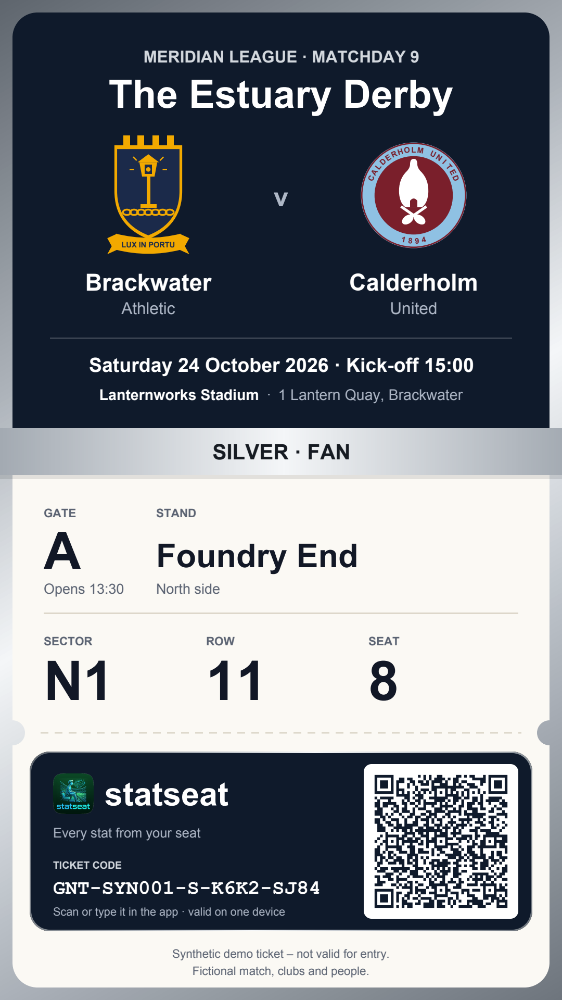
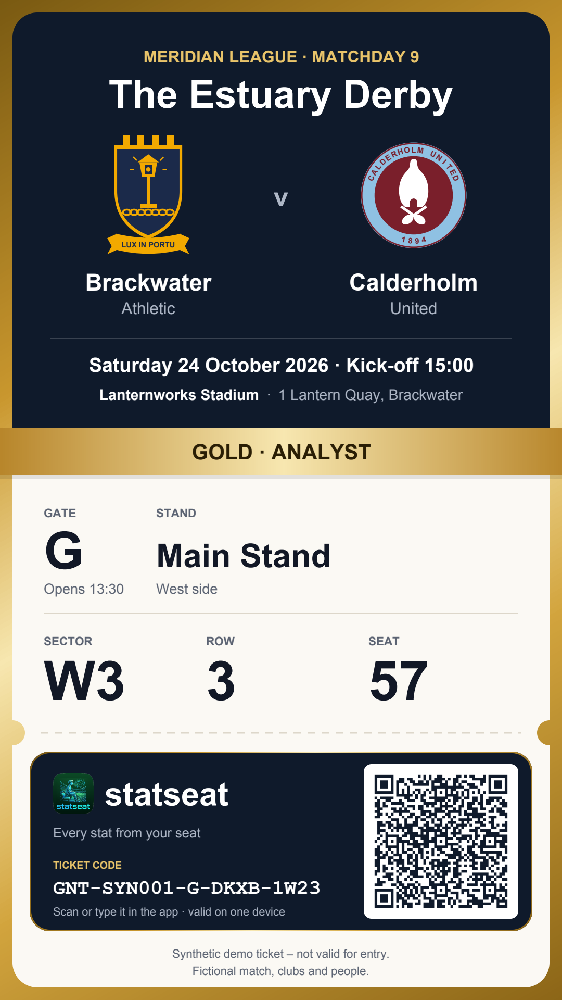
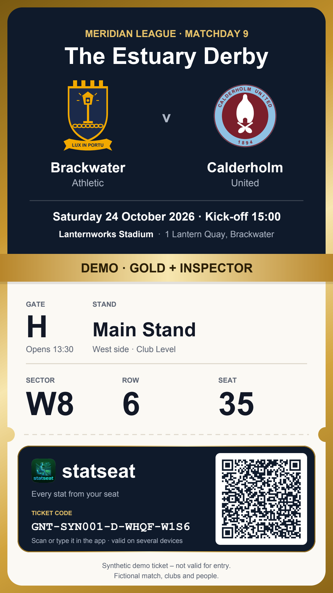

# statseat tickets: SYN-001

> **Synthetic demo tickets – not valid for entry.** The match (Brackwater Athletic v Calderholm United, The Estuary Derby), the clubs, the stadium and every person are fictional.

These are the digital tickets of the synthetic match **SYN-001**: Meridian League, matchday 9, Saturday 24 October 2026, kick-off 15:00, Lanternworks Stadium. A ticket code unlocks **statseat**, the fan companion app of InsideTheGame, for this match only. The tier of the ticket decides what the app shows.

This folder is generated by `generator/` (`python -m insidethegame_gen.tickets SYN-001`). Do not edit it by hand.

  
  
  

## How to log in

1. Open the statseat app (the demo link is in the main README of the repository).
2. Type one of the codes below, or scan the QR code on a ticket image. Upper or lower case, spaces and dashes do not matter; O counts as 0, and I or L as 1.
3. DEMO codes work on several devices at the same time. Silver and gold codes are bound to the first device that uses them, as a real fan's ticket would be.

## What each tier unlocks

| Tier | Letter | statseat mode | Inspector mode | Demo panel | Devices | Tickets | Seats |
|---|---|---|---|---|---|---|---|
| **DEMO** | D | Analyst, can switch to Fan | yes | yes | several | 12 | Main Stand, sector W8 (Club Level); gate H |
| **GOLD** | G | Analyst, can switch to Fan | no | no | one | 30 | Lamplighters Stand and Main Stand, sectors E4, E5, W3, W4; gates C, D, G, H |
| **SILVER** | S | Fan only | no | no | one | 120 | 18 home sectors in 4 stands; gates A, B, D, E, G, H |

- **Fan**: the match explained simply, for any fan. **Analyst**: the full statistics and the method behind them.
- **Inspector mode**: shows how each answer was made: the method, the agents and tools that were called, the tokens and the trace.
- **Demo panel**: jumps between the phases of the match (pre-match, live, half-time, full time), so the whole app can be seen in a few minutes.

## DEMO codes (Gold + Inspector + demo panel)

For the hackathon judges, the demo and the video. The seats are together in the Club Level of the Main Stand.

| Ticket | Code | Seat | Ticket image |
|---|---|---|---|
| SYN-001-D-001 | `GNT-SYN001-D-WHQF-W1S6` | Gate H · Main Stand · sector W8 · row 6 · seat 35 | [SVG](svg/demo-001.svg) · [PDF](pdf/demo-001.pdf) · [PNG](png/demo-001.png) |
| SYN-001-D-002 | `GNT-SYN001-D-3WD7-9SRW` | Gate H · Main Stand · sector W8 · row 6 · seat 36 | [SVG](svg/demo-002.svg) · [PDF](pdf/demo-002.pdf) · [PNG](png/demo-002.png) |
| SYN-001-D-003 | `GNT-SYN001-D-Q7VD-Z8D0` | Gate H · Main Stand · sector W8 · row 6 · seat 37 | [SVG](svg/demo-003.svg) · [PDF](pdf/demo-003.pdf) · [PNG](png/demo-003.png) |
| SYN-001-D-004 | `GNT-SYN001-D-97HJ-2JME` | Gate H · Main Stand · sector W8 · row 6 · seat 38 | [SVG](svg/demo-004.svg) · [PDF](pdf/demo-004.pdf) · [PNG](png/demo-004.png) |
| SYN-001-D-005 | `GNT-SYN001-D-FY05-RRWR` | Gate H · Main Stand · sector W8 · row 6 · seat 39 | [SVG](svg/demo-005.svg) · [PDF](pdf/demo-005.pdf) · [PNG](png/demo-005.png) |
| SYN-001-D-006 | `GNT-SYN001-D-DHNX-6VVA` | Gate H · Main Stand · sector W8 · row 6 · seat 40 | [SVG](svg/demo-006.svg) · [PDF](pdf/demo-006.pdf) · [PNG](png/demo-006.png) |
| SYN-001-D-007 | `GNT-SYN001-D-026S-AQWG` | Gate H · Main Stand · sector W8 · row 6 · seat 41 | [SVG](svg/demo-007.svg) · [PDF](pdf/demo-007.pdf) · [PNG](png/demo-007.png) |
| SYN-001-D-008 | `GNT-SYN001-D-CV10-VTJG` | Gate H · Main Stand · sector W8 · row 6 · seat 42 | [SVG](svg/demo-008.svg) · [PDF](pdf/demo-008.pdf) · [PNG](png/demo-008.png) |
| SYN-001-D-009 | `GNT-SYN001-D-112Y-YCXJ` | Gate H · Main Stand · sector W8 · row 6 · seat 43 | [SVG](svg/demo-009.svg) · [PDF](pdf/demo-009.pdf) · [PNG](png/demo-009.png) |
| SYN-001-D-010 | `GNT-SYN001-D-T4CZ-2GPA` | Gate H · Main Stand · sector W8 · row 6 · seat 44 | [SVG](svg/demo-010.svg) · [PDF](pdf/demo-010.pdf) · [PNG](png/demo-010.png) |
| SYN-001-D-011 | `GNT-SYN001-D-9TXQ-DZH1` | Gate H · Main Stand · sector W8 · row 6 · seat 45 | [SVG](svg/demo-011.svg) · [PDF](pdf/demo-011.pdf) · [PNG](png/demo-011.png) |
| SYN-001-D-012 | `GNT-SYN001-D-MRJR-MJ9G` | Gate H · Main Stand · sector W8 · row 6 · seat 46 | [SVG](svg/demo-012.svg) · [PDF](pdf/demo-012.pdf) · [PNG](png/demo-012.png) |

## Sample silver and gold tickets

Ordinary fans' tickets, one device each. Their codes are printed on the sample images.

| Ticket | Code | Seat | Ticket image |
|---|---|---|---|
| SYN-001-G-001 | `GNT-SYN001-G-DKXB-1W23` | Gate G · Main Stand · sector W3 · row 3 · seat 57 | [SVG](svg/gold-001.svg) · [PDF](pdf/gold-001.pdf) · [PNG](png/gold-001.png) |
| SYN-001-G-002 | `GNT-SYN001-G-6JYP-9JWA` | Gate H · Main Stand · sector W4 · row 5 · seat 35 | [SVG](svg/gold-002.svg) · [PDF](pdf/gold-002.pdf) · [PNG](png/gold-002.png) |
| SYN-001-G-003 | `GNT-SYN001-G-V5XT-N5NC` | Gate C · Lamplighters Stand · sector E4 · row 4 · seat 58 | [SVG](svg/gold-003.svg) · [PDF](pdf/gold-003.pdf) · [PNG](png/gold-003.png) |
| SYN-001-G-004 | `GNT-SYN001-G-23QM-R8HJ` | Gate D · Lamplighters Stand · sector E5 · row 4 · seat 20 | [SVG](svg/gold-004.svg) · [PDF](pdf/gold-004.pdf) · [PNG](png/gold-004.png) |
| SYN-001-S-001 | `GNT-SYN001-S-K6K2-SJ84` | Gate A · Foundry End · sector N1 · row 11 · seat 8 | [SVG](svg/silver-001.svg) · [PDF](pdf/silver-001.pdf) · [PNG](png/silver-001.png) |
| SYN-001-S-002 | `GNT-SYN001-S-RDY3-TK6X` | Gate A · Foundry End · sector N2 · row 29 · seat 75 | [SVG](svg/silver-002.svg) · [PDF](pdf/silver-002.pdf) · [PNG](png/silver-002.png) |
| SYN-001-S-003 | `GNT-SYN001-S-0P9E-EWAD` | Gate A · Foundry End · sector N3 · row 33 · seat 6 | [SVG](svg/silver-003.svg) · [PDF](pdf/silver-003.pdf) · [PNG](png/silver-003.png) |
| SYN-001-S-004 | `GNT-SYN001-S-P68E-2YW3` | Gate B · Foundry End · sector N4 · row 14 · seat 69 | [SVG](svg/silver-004.svg) · [PDF](pdf/silver-004.pdf) · [PNG](png/silver-004.png) |

The other 142 codes are not published: the registry keeps only their hashes.

## How the codes work

- **Format**: `GNT-SYN001-<tier>-XXXX-XXXX`. `GNT` is the app, `SYN001` the match, the tier letter is S (silver), G (gold) or D (demo).
- **Alphabet**: the last 8 characters use Crockford base32 (digits and capital letters without I, L, O and U), so no two characters look alike.
- **Check character**: the last character is computed from all the others (Luhn mod 32), so the app catches any single mistyped character before asking the server.
- **Hashes only**: the registry [`tickets.json`](tickets.json) lists all 162 tickets with tier, features and seat, and for each code only `code_sha256`, the SHA-256 of the normalised code (upper case, with dashes). The server does the same: it hashes what the fan types and looks the hash up.
- **QR code**: it contains a login link, `https://ca-statseat-ewwubzrkf5dus.happyriver-a61de2d4.switzerlandnorth.azurecontainerapps.io/?ticket=<code>`.
- **Limits**: these are demo credentials. They are derived from public inputs (the universe seed, the match id and the generator code are all in this repository), so anyone can regenerate them, and a hash of a code this short can be reversed by brute force. That is fine for a synthetic demo. In production, the ticketing system would derive the codes from a secret key kept in Azure Key Vault, and the server would store only salted hashes.
- **Seats**: gates, stands and sectors come from the stadium data; rows and seat numbers are synthetic (about 80 seats per row). Home tickets never use the away section.

## Files

| File | Content |
|---|---|
| [`tickets.json`](tickets.json) | the registry: 162 tickets, hashes only, with an alt text for each ticket |
| `png/` | ticket images, 1080 × 1920 px (a phone screen) |
| `pdf/` | the same tickets as PDF, 540 × 960 pt |
| `svg/` | the same tickets as SVG, 720 × 1280, with a title and a description for screen readers |

Rendered tickets: every DEMO ticket, plus four silver and four gold samples. Crests: the club crest from `synthetic/crests/<club_id>.svg` when it exists, otherwise a plain placeholder shield in the club's home-kit colours.
